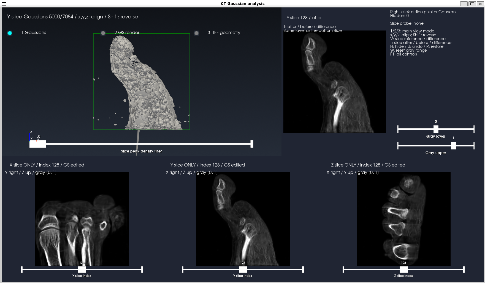
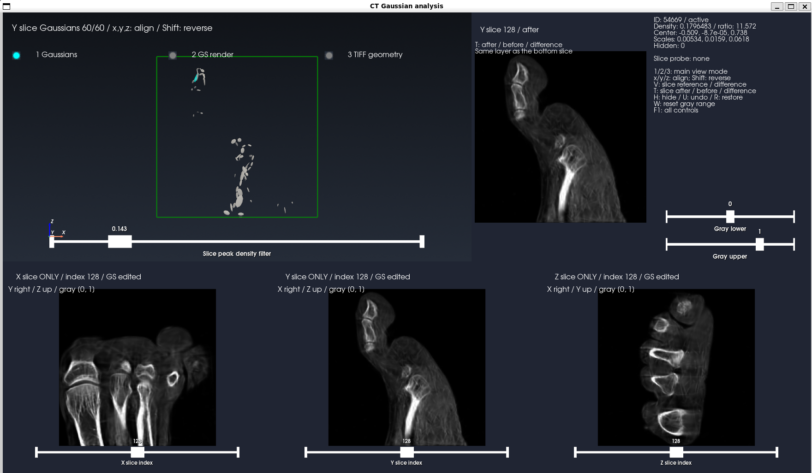
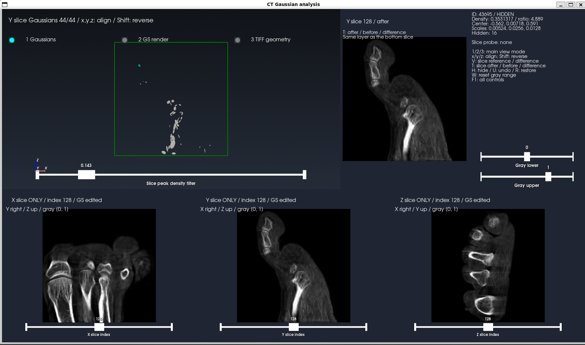
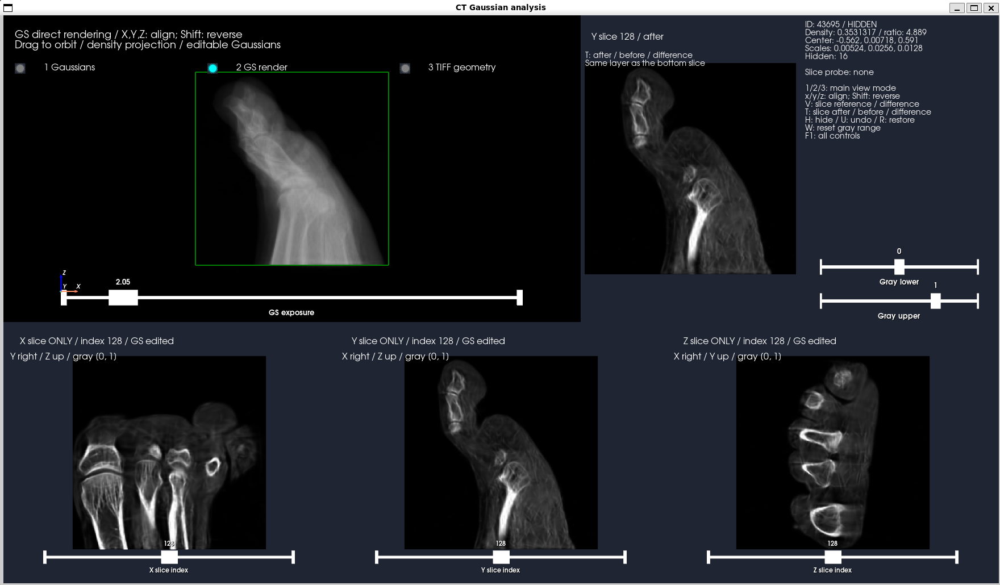
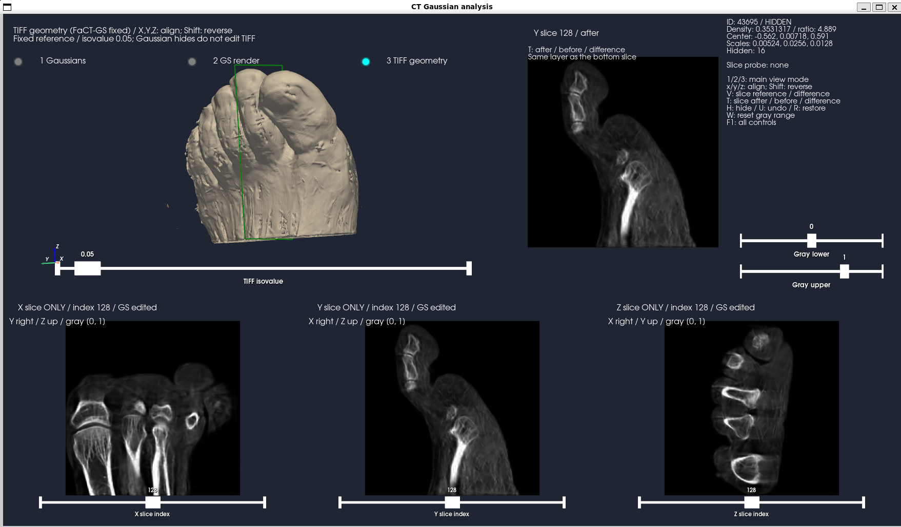

# CT-GS Viewer

**Interactive inspection of Gaussian-based CT reconstructions, linking individual Gaussian primitives to reconstructed slices.**

CT-GS Viewer helps investigate a practical question: **which Gaussians contribute to a structure in a CT slice, and what changes when those Gaussians are hidden?** It brings Gaussian geometry, direct density rendering, orthogonal slices, and reversible primitive removal into one analysis window.

The viewer operates on exported, activated Gaussian parameters. Training and reconstruction are performed separately. FaCT-GS and R²-Gaussian results can be inspected after conversion to the input format below.



*Slice-aligned inspection of a foot reconstruction. The main view displays 5,000 of 7,084 matching Gaussians; the bottom panels show X, Y, and Z slices at index 128 with a shared gray range of 0–1.*

## Research workflow

1. Navigate the X, Y, and Z slices to locate a feature or suspected artifact.
2. Align the main view with that slice using `x`, `y`, or `z`.
3. Right-click a slice pixel to rank its contributing Gaussians, or pick an ellipsoid to inspect its parameters.
4. Hide a selected Gaussian and inspect the recomputed slices at the same positions and gray range.
5. Toggle before/after/difference views, undo the edit, or export the analysis.

This supports a controlled removal experiment. A large density contribution identifies a candidate for inspection; it does not by itself establish that the primitive causes an artifact. Removing a primitive may also remove valid anatomy.

## Interface

| Region | Purpose |
| --- | --- |
| Upper left | Switch between Gaussian ellipsoids, direct GS rendering, and fixed TIFF geometry. |
| Upper middle | Inspect the active-axis slice after edits, before edits, or as a difference image. This panel shows a single slice. |
| Upper right | Inspect selected parameters, contribution candidates, hidden counts, and shared gray-range controls. |
| Bottom row | Navigate three orthogonal slices with independent slice-position sliders. |

The three main-view modes serve different purposes:

- **Gaussians:** inspect solid ellipsoid meshes associated with the active slice. The peak-density filter and display-count limit reduce visual clutter. They affect displayed meshes, while density slices use all nonhidden Gaussians.
- **GS render:** render an orthographic density projection directly from Gaussian parameters on the GPU, without first building a voxel volume. This integrates through the model and therefore differs from a single CT slice.
- **TIFF geometry:** inspect an isosurface extracted from a fixed reference volume. Hiding Gaussians does not modify that reference surface.

### Inspect and hide individual primitives



*Selecting a Gaussian exposes its original ID, density, center, scales, and aspect ratio. The slice peak-density display threshold is 0.143; 60 primitives are visible, and none are hidden.*



*After 16 primitives are hidden, 44 remain visible under the display filter and the slices are recomputed from the edited model. These screenshots show the interaction sequence; they do not establish an improvement in reconstruction quality.*

### Alternative main-view modes

| Direct GS density rendering | Fixed TIFF geometry |
| --- | --- |
|  |  |

*Direct rendering accumulates density through the editable Gaussian model. TIFF geometry shows a fixed reference isosurface at 0.05. Both screenshots retain the same 16-hidden-primitive edit state; the TIFF itself is unchanged.*

All six screenshots, including the display-filter example, are described in [the screenshot gallery](docs/SCREENSHOTS.md).

## Installation

The current dependency specification uses Python 3.12. A graphical desktop and an OpenGL 3.3-capable backend are required. The analysis worker tries EGL first, then the default standalone OpenGL backend. CUDA and the training repositories are not required to run the viewer.

From the project directory:

```bash
conda env create -f environment.yml
conda activate ct-gs-viewer
```

If this environment already exists, activate it and install the dependencies:

```bash
conda activate ct-gs-viewer
python -m pip install -r requirements.txt
```

Linux/WSL is the current development setup. Other operating systems have not been validated.

## Quick start: synthetic example

Generate a small three-Gaussian model and an aligned 64³ reference volume. No external dataset is needed.

```bash
python script/generate_demo.py
python script/density_viewer.py --mode analysis \
  --input data/demo/gaussians.npz \
  --metadata data/demo/meta_data.json \
  --fact-volume data/demo/reference.tiff \
  --analysis-resolution 64
```

The `--fact-volume` option is the historical name of the first reference-volume slot. Here it loads the synthetic reference, not a FaCT-GS reconstruction.

Press `y` to align with the middle bottom slice. Right-click an ellipsoid, press `h` to hide it, then press `t` to cycle the upper-middle slice through after, before, and difference views. Press `u` to undo.

## Load a reconstruction

Use explicit paths when inspecting your own exports:

```bash
python script/density_viewer.py --mode analysis \
  --input /path/to/gaussians.npz \
  --metadata /path/to/meta_data.json \
  --fact-volume /path/to/vol_pred.tiff \
  --gray-range 0 1 \
  --output output/my-analysis
```

Optional `--gt-volume` and `--r2-volume` arguments add aligned reference volumes. Gray limits are display settings; choose limits appropriate to the data. The viewer does not automatically register volumes or normalize their physical density scales.

Standalone views are also available:

```bash
python script/density_viewer.py --mode gaussians --input /path/to/gaussians.npz
python script/density_viewer.py --mode render --input /path/to/gaussians.npz
python script/density_viewer.py --mode tiff --input /path/to/vol_pred.tiff
```

### Gaussian NPZ format

| Array | Shape | Meaning |
| --- | --- | --- |
| `centers` | `(N, 3)` | Gaussian centers in world XYZ coordinates. |
| `scales` | `(N, 3)` | Positive, activated standard deviations along principal axes. |
| `rotations` | `(N, 3, 3)` | Rotation matrices mapping local axes to world axes. |
| `density` | `(N,)` | Nonnegative, activated peak densities. |
| `original_ids` (optional) | `(N,)` | Unique nonnegative integer IDs preserved during inspection and export. |

The covariance is `R @ diag(scales**2) @ R.T`. Raw logarithmic scales, quaternions, and unactivated density parameters must be converted before loading. Training checkpoints and pickle files are not accepted directly by this standalone project.

### Metadata and reference volumes

Minimal metadata:

```json
{
  "bbox": [[-1, -1, -1], [1, 1, 1]],
  "scanner": {"nVoxel": [256, 256, 256]}
}
```

`bbox` contains the lower and upper world XYZ bounds. Reference NPY/TIFF arrays must use the viewer's **XYZ array order** and match `nVoxel`. Convert conventional ZYX arrays before loading when necessary; file extensions alone do not establish axis order. The voxel center at index `i` lies at `lower + (i + 0.5) * (upper - lower) / nVoxel`. Slice indices are zero-based.

## Analysis controls

Use letter keys without Shift unless a reverse view is intended.

| Input | Action |
| --- | --- |
| `1` / `2` / `3` | Gaussian geometry / direct GS rendering / TIFF geometry. |
| `x` / `y` / `z` | Align the main view with the corresponding bottom slice; Shift reverses the viewing direction. |
| Right-click a slice | Query contributing Gaussians at a pixel. |
| Right-click an ellipsoid | Select a Gaussian and inspect its original ID, density, center, scales, and aspect ratio. |
| `n` / `p` | Move through ranked contribution candidates. |
| `b` | Toggle region picking to query contributions over a slice rectangle. |
| `h` | Hide the selected Gaussian. |
| `g` | Hide the current contribution candidate group. |
| `u` / `r` | Undo the last hide operation / restore all hidden Gaussians. |
| `t` | Cycle the upper-middle slice: after / before / difference. |
| `v` | Cycle the bottom slice source through edited, difference, and available fixed references. |
| `w` | Reset the shared gray range. |
| `j` | Move the slices to the selected Gaussian. |
| `c` / `l` | Save / load the main camera. |
| `s` | Export the edited model and current analysis. |
| `F1` | Show additional controls. |
| `q` | Close the viewer. |

Camera JSON files and command-line camera settings are supported; run `python script/density_viewer.py --help` for the full interface. Analysis and direct rendering currently require orthographic cameras.

## What is computed?

For a point **x**, primitive *i* contributes:

```text
w_i(x) = density_i * exp(-0.5 * (x-center_i)^T * covariance_i^-1 * (x-center_i))
```

Dynamic slices and contribution queries use a three-standard-deviation Mahalanobis cutoff. Point queries rank the actual density contribution at the probe. Region queries sum each primitive's contributions at the pixel centers inside the rectangle. Reported shares are relative to the total active contribution at that probe or region.

Hiding a primitive removes its contribution from the editable model. Slices are reevaluated from the Gaussian parameters; they are not read back from the fixed TIFF. The original model provides the before-edit slice, and the difference view shows the density removed by the edits.

Direct rendering uses an analytic Gaussian line integral with projected support truncated at three standard deviations. Accumulated density is mapped to display intensity using `1 - exp(-exposure * integral)`. It is a density visualization, not a calibrated detector simulator. Its projection support differs from the bounded support used for point and slice evaluation.

## Export

Press `s` to write to `--output`:

- `edited_parameters.npz` and `edits.json`: remaining primitives and edit provenance.
- `analysis_slices.npz`: edited and baseline slices along all three axes.
- `analysis_state.json`: positions, gray range, resolution, display settings, and reference labels.
- `contributions.json`: current probe and ranked contributions, when a query exists.
- `camera.json` by default, and `analysis.png`: saved camera and window screenshot.

A custom `--camera-save` path overrides the default camera destination. Exports capture an analysis result; they are not a complete session-restore mechanism.

## Validation and limitations

### Development checks

Install the development tools in the activated environment:

```bash
python -m pip install -r requirements-dev.txt
```

Black owns Python formatting; Ruff checks imports, unused names, and selected
syntax/style errors. Both use Python 3.12 and a 100-character target line length
configured in `pyproject.toml`. Shader strings retain their GLSL formatting.

```bash
# Apply import fixes, then format Python.
python -m ruff check --fix .
python -m black .

# Read-only checks before committing.
python -m ruff check .
python -m black --check .
```

Key geometry and evaluation functions document parameters, return values, units,
and array orientation in their docstrings. World vectors and reference volumes use
XYZ order. Slice rasters use `[row, column]` with a lower-edge row origin; screen
right/up follow the remaining axes in ascending order. Internal selection and
candidate arrays contain source row indices; persistent `original_ids` are used
for user-facing identification and exports.

### Tests

Run the numerical and camera checks:

```bash
python -m unittest discover -s script -p 'test_*.py'
```

GPU checks require a working EGL context and may be skipped when it is unavailable. To include the interactive-window integration checks on a machine with a working VTK graphics backend:

```bash
CT_VIEWER_UI_TESTS=1 python -m unittest discover -s script -p 'test_*.py'
```

Ellipsoids are triangulated display meshes, not exact analytic surfaces. Rendering speed depends on model size, image resolution, and graphics hardware; there is no guaranteed frame rate. Training-export conventions, density normalization, and truncation may differ from this viewer, so agreement with an independently exported reconstruction should be checked before quantitative interpretation.

On WSLg, if VTK cannot connect to the display, check that WSLg is available and try `export DISPLAY=:0`. A headless terminal alone cannot provide an interactive window.

## Project scope and license

This repository contains the viewer, tests, and a synthetic-data generator. Training repositories, checkpoints, and CT datasets are not bundled. FaCT-GS and R²-Gaussian are external reconstruction methods; their code and data retain their own licenses. NumPy, SciPy, PyVista/VTK, ModernGL, GLFW, Matplotlib, Pillow, and tifffile are separately licensed dependencies.

Viewer code is distributed under the [MIT License](LICENSE).
