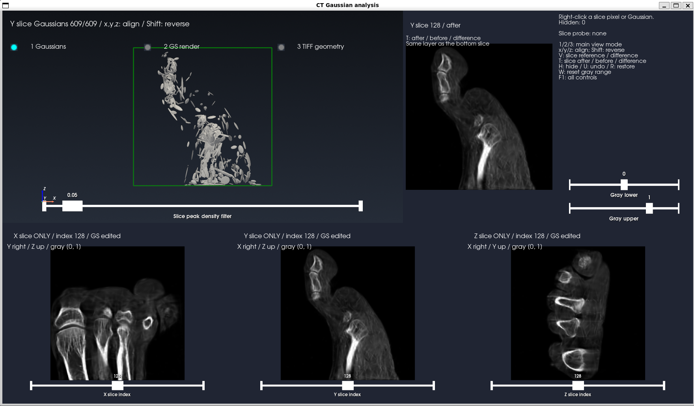
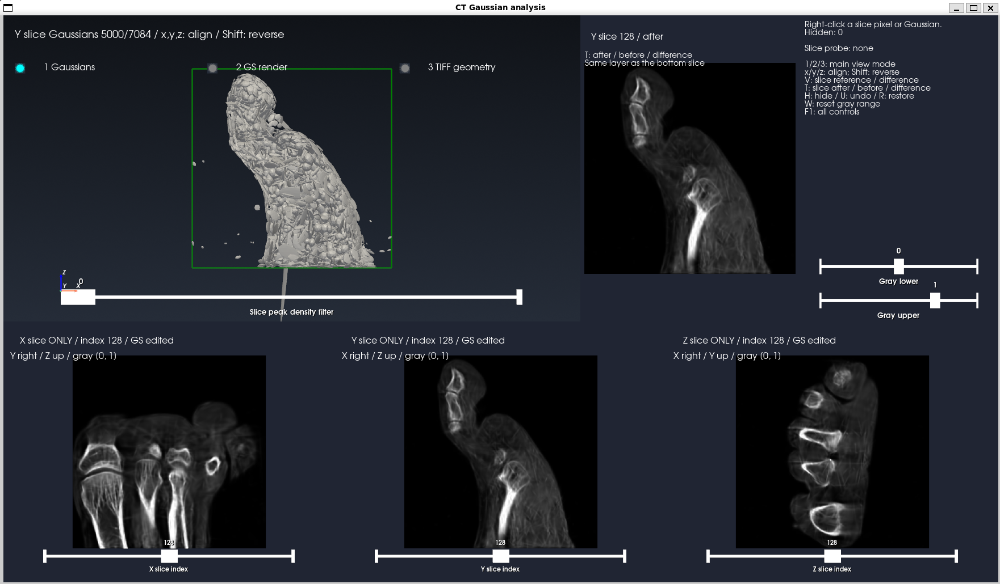
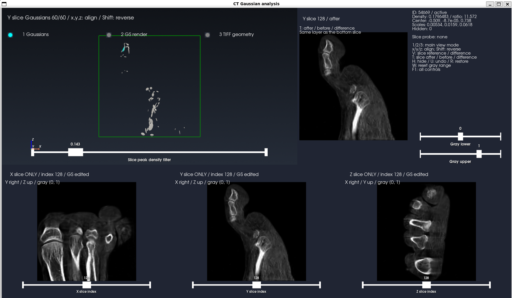
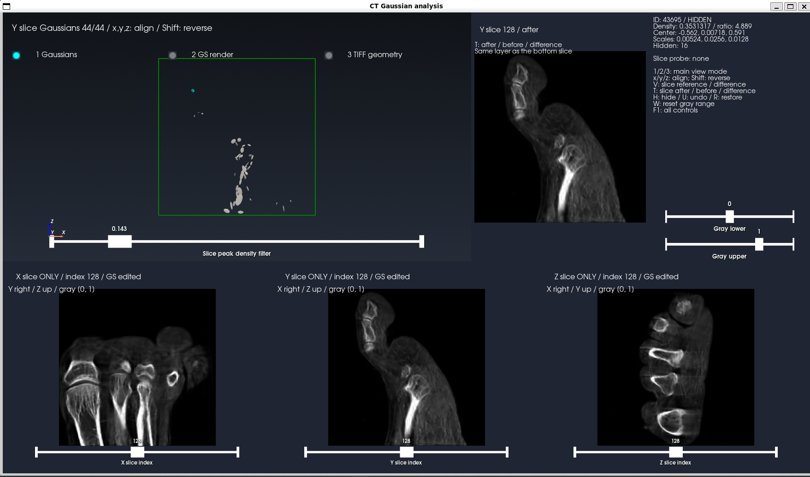
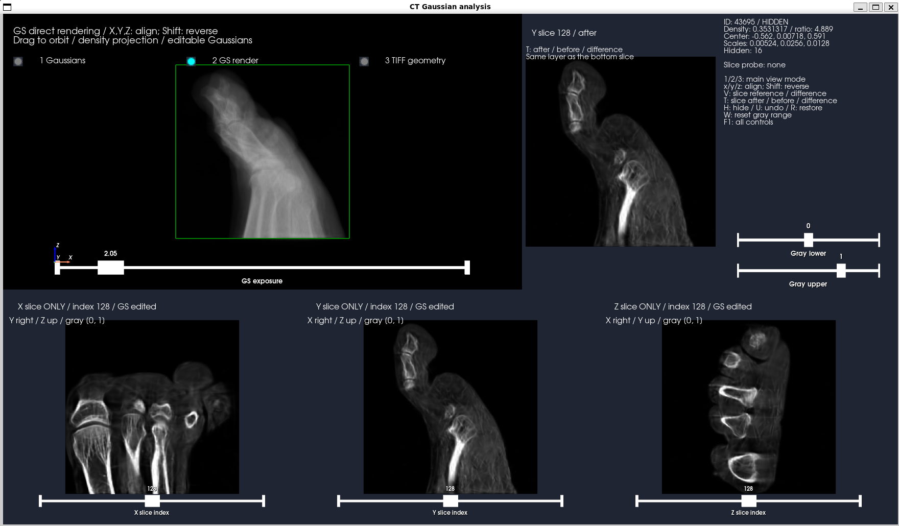
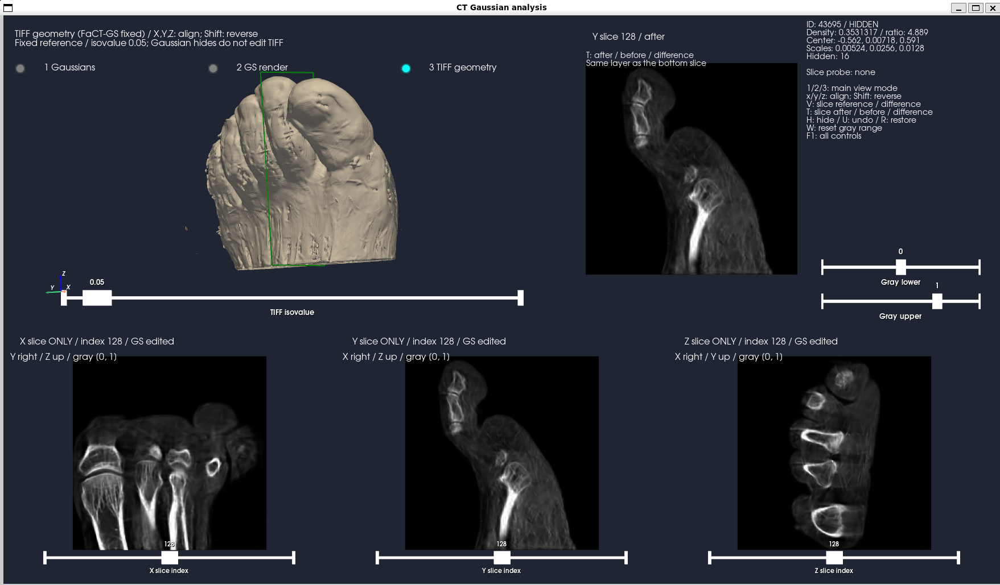

# Screenshot guide

The six screenshots supplied during development are preserved in `images/` at their original uploaded resolution. They illustrate the states below.

| Supplied image | Suggested filename | English caption |
| --- | --- | --- |
| 1 | `gaussian-filtered.png` | Slice-aligned Gaussian geometry with a peak-density display threshold of 0.05. The main view shows 609 of 609 matching primitives; the orthogonal slices remain evaluated from the active model. |
| 2 | `gaussian-overview.png` | Lowering the display threshold reveals more slice-supporting primitives: 5,000 are shown out of 7,084 matches. The unchanged slices demonstrate that mesh filtering changes visibility rather than model density. |
| 3 | `gaussian-selected.png` | A selected Gaussian is highlighted and its original ID, density, center, scales, and aspect ratio are displayed. With a display threshold of 0.143, 60 primitives are shown. No primitives are hidden. |
| 4 | `gaussian-hidden.png` | After hiding 16 primitives, the editable model's slices are updated. The selected primitive is marked HIDDEN, and 44 primitives remain visible under the current display filter. |
| 5 | `direct-render.png` | Direct Gaussian density projection in the main view, alongside the editable single-layer slice and three orthogonal slices. The hidden count remains 16. |
| 6 | `tiff-geometry.png` | Fixed TIFF isosurface at an isovalue of 0.05 provides geometric context. It is unaffected by Gaussian removal; the editable slices retain the current hidden-primitive state. |

The README uses image 2 as the overview, images 3–4 as a selection/removal sequence, and images 5–6 for the alternative main-view modes. Image 1 illustrates display filtering below.

## Display filtering

## Overview

## Selection

## Hidden primitives

## Direct rendering

## TIFF geometry

All six supplied views show the Y comparison slice at index 128 and shared gray limits of 0–1. The upper-middle panel is set to after-edit mode. These screenshots demonstrate interaction states; they do not by themselves quantify artifact reduction. A before/after/difference sequence at an unchanged camera and slice position would provide stronger evidence of the effect of removal.
